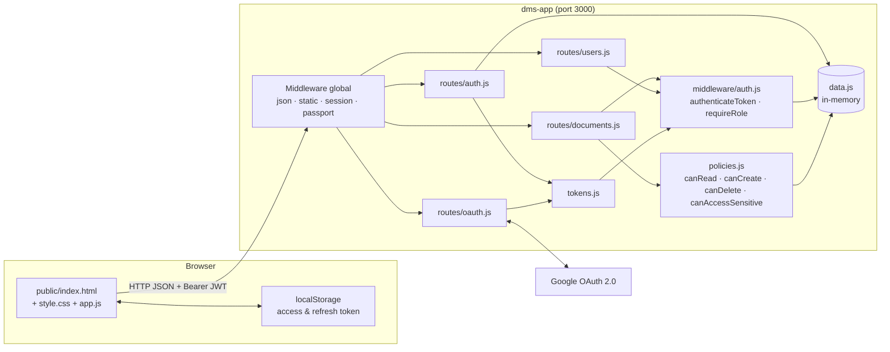
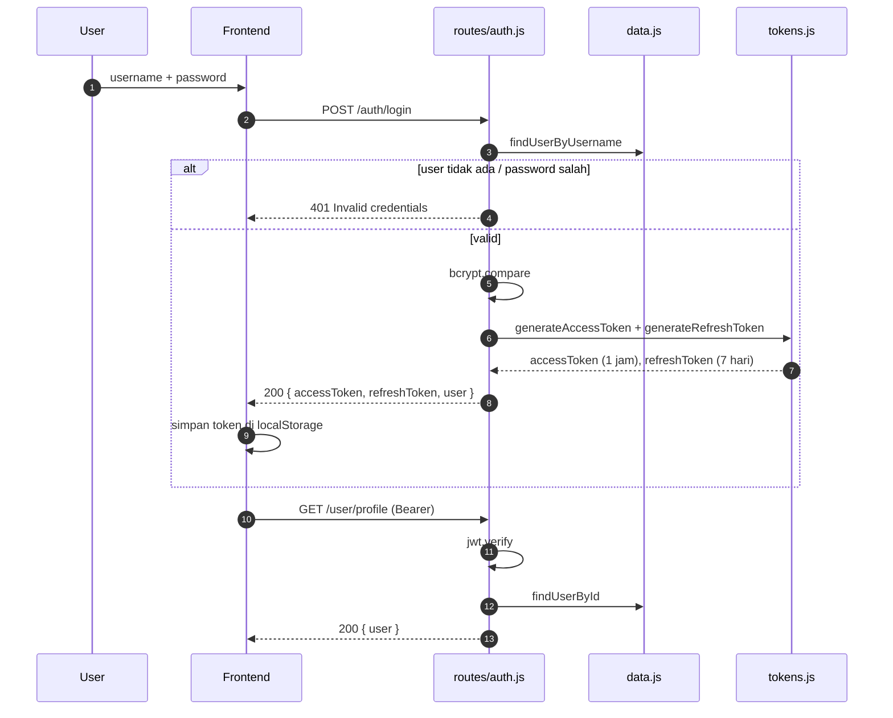
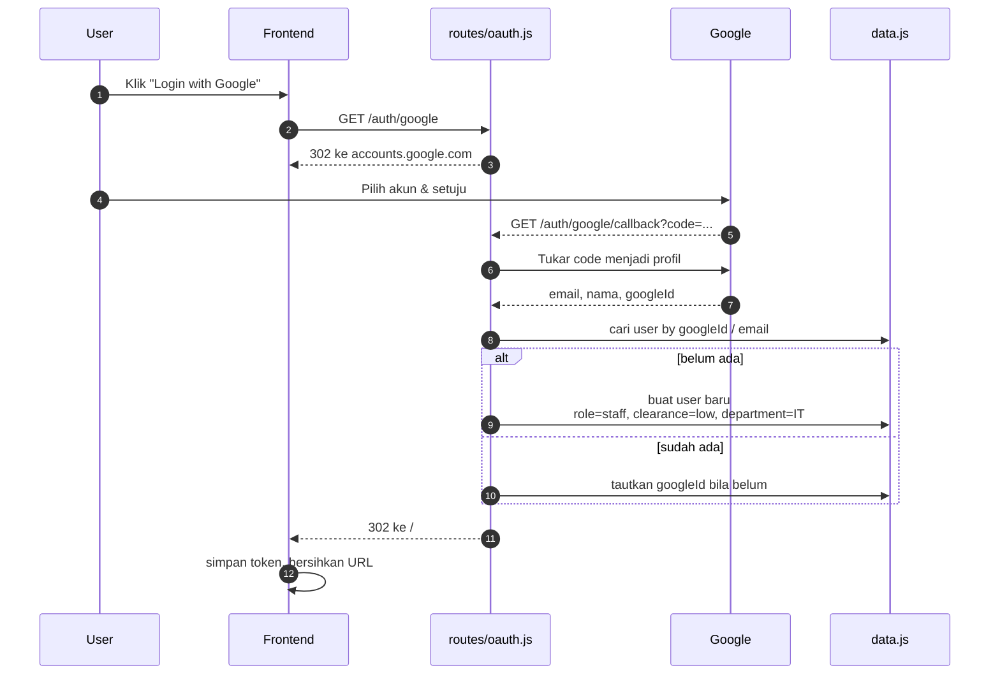
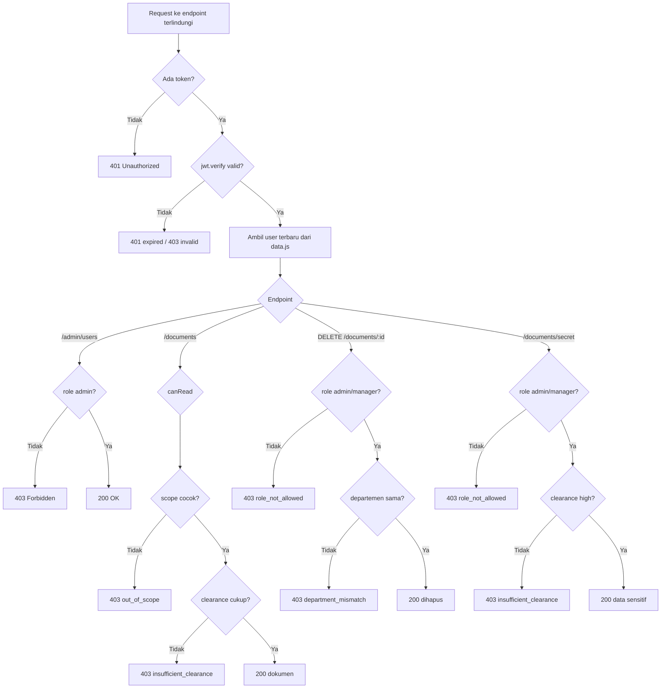

# DMS App — Laporan Proyek & Panduan Demo

Aplikasi **Document Management System (DMS)** berbasis **Node.js + Express** yang mendemonstrasikan empat mekanisme keamanan dalam satu aplikasi:

1. **Access Token** — JWT (login username/password) dan OAuth 2.0 (Google).
2. **RBAC** — kontrol akses berdasarkan peran.
3. **ABAC** — kontrol akses berdasarkan atribut user dan dokumen.
4. **Gabungan RBAC + ABAC** — keputusan yang membutuhkan peran **dan** atribut sekaligus.

Data disimpan **in-memory** agar fokus pada logika autentikasi dan otorisasi, bukan konfigurasi database.

---

## Daftar Isi

1. [Fitur](#1-fitur)
2. [Teknologi](#2-teknologi)
3. [Struktur Proyek](#3-struktur-proyek)
4. [Cara Menjalankan](#4-cara-menjalankan)
5. [Akun Demo & Data Awal](#5-akun-demo--data-awal)
6. [Arsitektur & Alur](#6-arsitektur--alur)
7. [Mekanisme Keamanan](#7-mekanisme-keamanan)
8. [Daftar Endpoint](#8-daftar-endpoint)
9. [Cara Demo](#9-cara-demo)
10. [Matriks Hasil Pengujian](#10-matriks-hasil-pengujian)
11. [Troubleshooting](#11-troubleshooting)
12. [Catatan Desain & Keamanan](#12-catatan-desain--keamanan)
13. [Checklist Push ke GitHub](#13-checklist-push-ke-github)

---

## 1. Fitur

| Requirement | Implementasi | Bukti |
|---|---|---|
| **Access Token** | JWT access token (1 jam) + refresh token (7 hari). Login juga bisa lewat Google OAuth 2.0. | `POST /auth/login`, `GET /user/profile` |
| **RBAC** | Middleware `requireRole('admin')` pada endpoint admin. | `GET /admin/users` → admin 200, manager/staff 403 |
| **ABAC** | Policy `canRead` dan `canCreate` memakai `department`, `clearance`, `ownerId`, `classification`. | `GET /documents`, `POST /documents` |
| **Gabungan RBAC + ABAC** | `canDelete` (role **dan** departemen) serta `canAccessSensitive` (role **dan** clearance). | `DELETE /documents/:id`, `GET /documents/secret` |
| **OAuth 2.0** | Passport Google Strategy; hasil akhir tetap JWT aplikasi. | `GET /auth/google` → callback → `/#token=...` |

---

## 2. Teknologi

| Komponen | Versi / Keterangan |
|---|---|
| Runtime | Node.js 18+ |
| Framework | Express 5 |
| Autentikasi | `jsonwebtoken`, `bcryptjs` |
| OAuth | `passport`, `passport-google-oauth20`, `express-session` |
| View | EJS (halaman login gagal) |
| Frontend | HTML + CSS + JavaScript murni (tanpa framework) |
| Penyimpanan | In-memory (`src/data.js`) |

---

## 3. Struktur Proyek

```
dms-app/
├── package.json
├── .gitignore              # node_modules, .env, log
├── .env                    # TIDAK di-commit (berisi secret)
├── src/
│   ├── server.js           # entry point: middleware global + daftar route
│   ├── data.js             # "database" in-memory: users, documents, counter ID
│   ├── tokens.js           # pembuat access/refresh token + daftar refresh aktif
│   ├── policies.js         # seluruh aturan ABAC & gabungan
│   ├── middleware/
│   │   └── auth.js         # authenticateToken + requireRole
│   └── routes/
│       ├── auth.js         # register, login, refresh, logout, profile
│       ├── users.js        # endpoint admin (RBAC)
│       ├── documents.js    # CRUD dokumen (ABAC + gabungan)
│       └── oauth.js        # konfigurasi & route Google OAuth
├── public/
│   ├── index.html          # struktur halaman
│   ├── style.css           # tampilan
│   └── app.js              # logika frontend (token, fetch, render)
└── views/
    └── login-failed.ejs    # halaman jika OAuth gagal
```

### Penjelasan file inti

| File | Tanggung jawab |
|---|---|
| `src/server.js` | Memasang `express.json`, session, Passport, static file, lalu seluruh router. |
| `src/data.js` | Menyimpan user & dokumen. Counter ID (`nextUserId`, `nextDocId`) dinaikkan dengan `++` saat membuat data baru, sehingga ID tidak bentrok setelah penghapusan. |
| `src/tokens.js` | `generateAccessToken` (1 jam), `generateRefreshToken` (7 hari), dan `refreshTokens` (Set) untuk mencabut token saat logout. |
| `src/middleware/auth.js` | Membaca `Authorization: Bearer`, memverifikasi JWT, mengambil user terbaru dari `data.js`, lalu mengisi `req.user`. |
| `src/policies.js` | Satu sumber kebenaran aturan akses. Mengembalikan `{ allowed, reason, message }`, bukan sekadar boolean. |
| `src/routes/*.js` | Hanya menangani HTTP: validasi input, panggil policy, kirim response. |
| `public/app.js` | Menyimpan token, menambahkan header Authorization, menangani 401/403, dan merender data. |

---

## 4. Cara Menjalankan

### 4.1 Prasyarat

- Node.js 18 atau lebih baru
- npm
- (Opsional) Google Cloud OAuth Client jika ingin mencoba login Google

### 4.2 Instalasi

```bash
cd dms-app
npm install
```

### 4.3 Membuat `.env`

Buat file `dms-app/.env`:

```env
PORT=3000
JWT_SECRET=ganti-dengan-string-panjang-acak
SESSION_SECRET=ganti-dengan-string-panjang-acak
GOOGLE_CLIENT_ID=isi-client-id.apps.googleusercontent.com
GOOGLE_CLIENT_SECRET=isi-client-secret
CALLBACK_URL=http://localhost:3000/auth/google/callback
```

### 4.4 Konfigurasi Google OAuth (opsional)

1. Buka **Google Cloud Console** → **APIs & Services** → **Credentials**.
2. Buat **OAuth 2.0 Client ID** dengan tipe **Web application**.
3. Tambahkan **Authorized redirect URI**:
   ```
   http://localhost:3000/auth/google/callback
   ```
4. Pastikan `CALLBACK_URL` di `.env` **sama persis** dengan URI di atas.
5. Jika baru mengubah URI, tunggu ±5 menit dan tes di jendela incognito.

### 4.5 Menjalankan

```bash
npm start
```

Buka <http://localhost:3000>.

Mode pengembangan (auto-restart):

```bash
npm run dev
```

---

## 5. Akun Demo & Data Awal

### 5.1 Akun

| Username | Password | Role | Department | Clearance |
|---|---|---|---|---|
| `admin` | `admin123` | `admin` | IT | `high` |
| `manager` | `manager123` | `manager` | HR | `medium` |
| `staff` | `staff123` | `staff` | IT | `low` |

### 5.2 Dokumen seed (6 dokumen)

| ID | Judul | Department | Classification | Pemilik |
|---|---|---|---|---|
| 1 | Panduan Onboarding Karyawan | IT | `public` | staff |
| 2 | Laporan Gaji Q3 2025 | HR | `confidential` | manager |
| 3 | Rencana Strategis 2026 | IT | `secret` | admin |
| 4 | Kontrak Vendor Cloud | HR | `confidential` | manager |
| 5 | Catatan Rapat Tim IT | IT | `public` | staff |
| 6 | Arsitektur Keamanan Sistem | IT | `secret` | admin |

> Data kembali ke kondisi awal setiap kali server di-restart. Ini memudahkan pengujian berulang.

---

## 6. Arsitektur & Alur

### 6.1 Arsitektur komponen



### 6.2 Alur login JWT



### 6.3 Alur OAuth Google



### 6.4 Alur keputusan otorisasi



---

## 7. Mekanisme Keamanan

### 7.1 JWT: access token & refresh token

| Token | Isi payload | Masa berlaku | Fungsi |
|---|---|---|---|
| Access token | `id`, `username`, `role` | 1 jam | Mengakses endpoint terlindungi |
| Refresh token | `id`, `username`, `type: 'refresh'` | 7 hari | Meminta access token baru |

- Ditandatangani dengan `JWT_SECRET` dari `.env`.
- Access token **tidak menyimpan** `department`/`clearance`. Middleware selalu mengambil data terbaru dari `data.js`, sehingga perubahan atribut langsung berlaku.
- Refresh token disimpan di `Set` in-memory. Saat logout, token dihapus dari `Set` sehingga tidak bisa dipakai lagi.

### 7.2 Middleware `authenticateToken`

1. Membaca header `Authorization: Bearer <token>`.
2. Tidak ada token → **401**.
3. `jwt.verify` gagal:
   - kedaluwarsa → **401** (`Token expired`),
   - rusak/tidak valid → **403** (`Invalid token`).
4. User tidak ditemukan → **401**.
5. `passwordHash` dibuang, lalu `req.user` diisi data terbaru.

### 7.3 RBAC

RBAC dijalankan oleh `requireRole(...roles)` setelah `authenticateToken`:

```js
router.get('/admin/users', authenticateToken, requireRole('admin'), handler);
```

- Role tidak termasuk → **403**.
- Endpoint admin hanya bisa diakses `admin`.
- UI juga menyembunyikan section admin, tetapi penegakan sebenarnya tetap di server.

### 7.4 ABAC — membaca dokumen

Berlaku untuk `GET /documents` dan `GET /documents/:id`. Kedua syarat harus benar (**AND**):

| # | Aturan | Nilai |
|---|---|---|
| 1 | **Scope** | `admin`: semua dokumen<br>`manager`: `doc.department === user.department`<br>`staff`: `doc.ownerId === user.id` |
| 2 | **Clearance** | `level(user.clearance) >= level(doc.classification)` |

Skala level:

| Classification | Level | | Clearance | Level |
|---|---|---|---|---|
| `public` | 1 | | `low` | 1 |
| `confidential` | 2 | | `medium` | 2 |
| `secret` | 3 | | `high` | 3 |

Alasan penolakan: `out_of_scope`, `insufficient_clearance`.

### 7.5 ABAC — membuat dokumen

| # | Aturan | Nilai |
|---|---|---|
| 1 | Classification valid | `public` / `confidential` / `secret` |
| 2 | Clearance cukup | `level(user.clearance) >= level(classification)` |

`ownerId`, `ownerUsername`, dan `department` **diambil dari user yang login**, bukan dari body request, sehingga tidak bisa dipalsukan.

Alasan penolakan: `invalid_classification`, `insufficient_clearance`.

### 7.6 Gabungan RBAC + ABAC

**A. Hapus dokumen — `DELETE /documents/:id`**

| Dimensi | Aturan |
|---|---|
| RBAC | `role ∈ {admin, manager}` |
| ABAC | `doc.department === user.department` |
| Keputusan | **AND** |

Alasan: `role_not_allowed`, `department_mismatch`.

> Catatan desain: `admin` **juga** dibatasi departemen di endpoint ini agar aturan AND benar-benar murni. Konsekuensinya admin IT tidak bisa menghapus dokumen HR. Trade-off ini disengaja.

**B. Data sensitif — `GET /documents/secret`**

| Dimensi | Aturan |
|---|---|
| RBAC | `role ∈ {admin, manager}` |
| ABAC | `clearance === 'high'` |
| Keputusan | **AND** |

Alasan: `role_not_allowed`, `insufficient_clearance`.

> Route `/documents/secret` **harus dideklarasikan sebelum** `/documents/:id`. Jika urutannya terbalik, Express akan menganggap `"secret"` sebagai `:id` dan mengembalikan 400.

---

## 8. Daftar Endpoint

| Method | Path | Autentikasi | Policy / Keterangan |
|---|---|---|---|
| GET | `/` | publik | Halaman UI (`public/index.html`) |
| GET | `/health` | publik | Cek server hidup |
| GET | `/dev/seed` | publik | Data seed tanpa `passwordHash` (demo lokal) |
| POST | `/auth/register` | publik | Role dipaksa `staff`, clearance `low` |
| POST | `/auth/login` | publik | Mengembalikan access + refresh token |
| POST | `/auth/refresh` | refresh token | Access token baru |
| POST | `/auth/logout` | refresh token | Mencabut refresh token |
| GET | `/user/profile` | Bearer | Profil user login |
| GET | `/admin/users` | Bearer + admin | RBAC |
| GET | `/admin/users/:id` | Bearer + admin | RBAC |
| GET | `/documents` | Bearer | ABAC `canRead` (disaring) |
| GET | `/documents/secret` | Bearer | RBAC + ABAC `canAccessSensitive` |
| GET | `/documents/:id` | Bearer | ABAC `canRead` |
| POST | `/documents` | Bearer | ABAC `canCreate` |
| DELETE | `/documents/:id` | Bearer | RBAC + ABAC `canDelete` |
| GET | `/auth/google` | publik | Redirect ke Google |
| GET | `/auth/google/callback` | publik | Terbitkan JWT lalu redirect `/#token=...` |
| GET | `/auth/google/status` | publik | Status session Passport (demo) |
| GET | `/login-failed` | publik | Halaman OAuth gagal (401) |

### Format response error

```json
{
  "error": "Forbidden",
  "reason": "out_of_scope",
  "message": "Dokumen berada di luar cakupan akses Anda."
}
```

`reason` memudahkan menjelaskan **mengapa** akses ditolak saat demo.

---

## 9. Cara Demo

Demo dapat dilakukan lewat **browser** (paling mudah) atau **curl** (untuk bukti di laporan).

### 9.1 Demo lewat browser

Pastikan server berjalan dan buka <http://localhost:3000>.

#### Demo 1 — Login & JWT

1. Login sebagai `admin` / `admin123`.
2. Perhatikan profil: role `admin`, department `IT`, clearance `high`.
3. Klik **Logout**, lalu login sebagai `staff` / `staff123`.
4. Perhatikan: section **Admin: Daftar User** hilang.

**Yang dibuktikan:** token disimpan dan dikirim otomatis; tampilan menyesuaikan role.

#### Demo 2 — RBAC

1. Login sebagai `admin` → daftar user tampil.
2. Login sebagai `manager` atau `staff` → section admin tidak muncul.
3. Untuk bukti server (bukan hanya UI), jalankan curl pada bagian 9.2.

**Yang dibuktikan:** `GET /admin/users` hanya untuk admin.

#### Demo 3 — ABAC membaca dokumen

Login bergantian dan perhatikan counter dokumen:

| Login sebagai | Terlihat | Disembunyikan |
|---|---|---|
| `admin` | 6 | 0 |
| `manager` | 2 (#2, #4 — HR) | 4 |
| `staff` | 2 (#1, #5 — miliknya) | 4 |

Lalu klik **Detail** pada dokumen tertentu:

| Aksi | Hasil |
|---|---|
| `staff` membuka #3 (secret milik admin) | 403 `out_of_scope` |
| `manager` membuka #3 (IT) | 403 `out_of_scope` |
| `admin` membuka #6 | 200 |

**Yang dibuktikan:** scope dan clearance benar-benar menyaring data.

#### Demo 4 — ABAC membuat dokumen

1. Login `staff`, buat dokumen `public` → **berhasil** (201).
2. Login `staff`, pilih `secret` → **403 `insufficient_clearance`**.
3. Login `manager`, pilih `confidential` → **berhasil**.
4. Login `admin`, pilih `secret` → **berhasil**.

**Yang dibuktikan:** classification tidak boleh melebihi clearance.

#### Demo 5 — Gabungan RBAC + ABAC: data sensitif

Buka `GET /documents/secret` (bisa lewat curl):

| Login sebagai | Hasil |
|---|---|
| `admin` | 200, berisi 2 dokumen `secret` |
| `manager` | 403 `insufficient_clearance` |
| `staff` | 403 `role_not_allowed` |

Urutan pengecekan penting: **role dulu**, baru clearance. Karena itu staff mendapat `role_not_allowed`, bukan `insufficient_clearance`.

#### Demo 6 — Gabungan RBAC + ABAC: hapus dokumen

Login dan coba hapus:

| Aksi | Hasil |
|---|---|
| `staff` hapus #1 | 403 `role_not_allowed` |
| `manager` (HR) hapus #1 (IT) | 403 `department_mismatch` |
| `manager` (HR) hapus #2 (HR) | 200 |
| `admin` (IT) hapus #1 (IT) | 200 |
| `admin` (IT) hapus #4 (HR) | 403 `department_mismatch` |

> Penghapusan mengubah data in-memory. Restart server (`Ctrl+C`, lalu `npm start`) untuk mengembalikan data awal.

#### Demo 7 — OAuth Google

1. Klik **Login with Google**.
2. Pilih akun Google.
3. Setelah kembali, URL sempat berisi `/#token=...&refreshToken=...`, lalu dibersihkan otomatis.
4. Profil tampil. User Google baru otomatis mendapat `staff` / `low` / `IT`.

Jika muncul `redirect_uri_mismatch`, lihat bagian [Troubleshooting](#11-troubleshooting).

#### Demo 8 — Refresh & logout

1. Access token berlaku 1 jam; refresh token 7 hari.
2. `POST /auth/refresh` menukar refresh token dengan access token baru.
3. `POST /auth/logout` mencabut refresh token dari `Set`, sehingga tidak bisa dipakai lagi.

---

### 9.2 Demo lewat curl (bukti cepat)

> Ganti `$TOKEN` dengan access token hasil login. Di macOS/Linux bisa memakai `jq` bila tersedia.

**1) Login**

```bash
curl -s -X POST http://localhost:3000/auth/login \
  -H "Content-Type: application/json" \
  -d '{"username":"admin","password":"admin123"}'
```

Simpan `accessToken` ke variabel:

```bash
TOKEN=$(curl -s -X POST http://localhost:3000/auth/login \
  -H "Content-Type: application/json" \
  -d '{"username":"admin","password":"admin123"}' \
  | node -pe "JSON.parse(require('fs').readFileSync(0,'utf8')).accessToken")
```

**2) Profil**

```bash
curl -s http://localhost:3000/user/profile \
  -H "Authorization: Bearer $TOKEN"
```

**3) Tanpa token (harus 401)**

```bash
curl -s -o /dev/null -w "%{http_code}\n" http://localhost:3000/user/profile
```

**4) RBAC — manager ditolak (harus 403)**

```bash
MTOKEN=$(curl -s -X POST http://localhost:3000/auth/login \
  -H "Content-Type: application/json" \
  -d '{"username":"manager","password":"manager123"}' \
  | node -pe "JSON.parse(require('fs').readFileSync(0,'utf8')).accessToken")

curl -s -o /dev/null -w "%{http_code}\n" http://localhost:3000/admin/users \
  -H "Authorization: Bearer $MTOKEN"
```

**5) ABAC — staff melihat daftar (total 2, hidden 4)**

```bash
STOKEN=$(curl -s -X POST http://localhost:3000/auth/login \
  -H "Content-Type: application/json" \
  -d '{"username":"staff","password":"staff123"}' \
  | node -pe "JSON.parse(require('fs').readFileSync(0,'utf8')).accessToken")

curl -s http://localhost:3000/documents \
  -H "Authorization: Bearer $STOKEN"
```

**6) ABAC — staff membuka dokumen admin (harus `out_of_scope`)**

```bash
curl -s http://localhost:3000/documents/3 \
  -H "Authorization: Bearer $STOKEN"
```

**7) ABAC — staff membuat dokumen secret (harus `insufficient_clearance`)**

```bash
curl -s -X POST http://localhost:3000/documents \
  -H "Content-Type: application/json" \
  -H "Authorization: Bearer $STOKEN" \
  -d '{"title":"Coba Secret","classification":"secret"}'
```

**8) Data sensitif (admin 200, manager 403, staff 403)**

```bash
curl -s http://localhost:3000/documents/secret \
  -H "Authorization: Bearer $TOKEN"
```

**9) Hapus dokumen (gabungan RBAC + ABAC)**

```bash
# staff -> role_not_allowed
curl -s -X DELETE http://localhost:3000/documents/1 \
  -H "Authorization: Bearer $STOKEN"

# manager HR -> department_mismatch untuk dokumen IT
curl -s -X DELETE http://localhost:3000/documents/1 \
  -H "Authorization: Bearer $MTOKEN"

# manager HR -> 200 untuk dokumen HR
curl -s -X DELETE http://localhost:3000/documents/2 \
  -H "Authorization: Bearer $MTOKEN"
```

**10) Health & seed**

```bash
curl -s http://localhost:3000/health
curl -s http://localhost:3000/dev/seed
```

---

## 10. Matriks Hasil Pengujian

### 10.1 Autentikasi

| Skenario | Hasil |
|---|---|
| Login `admin/admin123` | 200 + access & refresh token |
| Profile tanpa token | 401 |
| Profile dengan token valid | 200 |
| Login password salah | 401 |
| Token palsu/rusak | 403 |
| Token kedaluwarsa | 401 |
| Refresh token valid | 200 + access token baru |
| Logout lalu refresh lagi | 403 |

### 10.2 RBAC

| Skenario | Hasil |
|---|---|
| `GET /admin/users` tanpa token | 401 |
| `GET /admin/users` sebagai admin | 200 |
| `GET /admin/users` sebagai manager | 403 |
| `GET /admin/users` sebagai staff | 403 |

### 10.3 ABAC baca

| Dokumen | Dept | Classification | admin | manager | staff |
|---|---|---|---|---|---|
| #1 Panduan Onboarding | IT | public | ✅ | ❌ `out_of_scope` | ✅ |
| #2 Laporan Gaji Q3 | HR | confidential | ✅ | ✅ | ❌ `out_of_scope` |
| #3 Rencana Strategis 2026 | IT | secret | ✅ | ❌ `out_of_scope` | ❌ `out_of_scope` |
| #4 Kontrak Vendor Cloud | HR | confidential | ✅ | ✅ | ❌ `out_of_scope` |
| #5 Catatan Rapat Tim IT | IT | public | ✅ | ❌ `out_of_scope` | ✅ |
| #6 Arsitektur Keamanan | IT | secret | ✅ | ❌ `out_of_scope` | ❌ `out_of_scope` |

Ringkasan: admin **6**, manager **2**, staff **2**.

### 10.4 ABAC buat

| Skenario | Hasil |
|---|---|
| staff membuat `public` | 201 |
| staff membuat `secret` | 403 `insufficient_clearance` |
| manager membuat `confidential` | 201 |
| admin membuat `secret` | 201 |
| classification tidak dikenal | 403 `invalid_classification` |
| title kosong | 400 |

### 10.5 Gabungan RBAC + ABAC

| Skenario | Hasil |
|---|---|
| `GET /documents/secret` admin | 200 (2 dokumen) |
| `GET /documents/secret` manager | 403 `insufficient_clearance` |
| `GET /documents/secret` staff | 403 `role_not_allowed` |
| staff hapus dokumen | 403 `role_not_allowed` |
| manager HR hapus dokumen IT | 403 `department_mismatch` |
| manager HR hapus dokumen HR | 200 |
| admin IT hapus dokumen IT | 200 |
| admin IT hapus dokumen HR | 403 `department_mismatch` |

### 10.6 OAuth

| Skenario | Hasil |
|---|---|
| `GET /auth/google` | 302 ke Google dengan `redirect_uri` benar |
| Callback berhasil | Redirect `/#token=...`, JWT terbit |
| `GET /login-failed` | 401 + halaman "Login Gagal" |

---

## 11. Troubleshooting

| Gejala | Penyebab | Solusi |
|---|---|---|
| `Error 400: redirect_uri_mismatch` | URI di Google Console ≠ `CALLBACK_URL` | Tambahkan `http://localhost:3000/auth/google/callback` pada OAuth Client tipe **Web application**, tunggu ±5 menit, tes incognito |
| `EADDRINUSE: port 3000` | Port dipakai proses lain | Hentikan proses lama atau ubah `PORT` di `.env` |
| Login selalu 401 | Password/username salah, atau data ter-reset | Gunakan akun demo; restart server mengembalikan data awal |
| `401 Token expired` | Access token lewat 1 jam | Panggil `/auth/refresh` atau login ulang |
| `403 Invalid token` | Token rusak / bukan dari server ini | Login ulang |
| Section admin tidak muncul | Role bukan admin | Login sebagai `admin` |
| Dokumen hilang setelah dicoba | Data in-memory berubah karena DELETE | Restart server |
| Google Client ID tidak terbaca | `.env` tidak ada / salah lokasi | Pastikan `.env` di dalam `dms-app/`, bukan di root |
| `Cannot find module` | Dependensi belum diinstal | Jalankan `npm install` |

### Perbedaan 401 dan 403

| Status | Arti |
|---|---|
| **401** | Belum terautentikasi: tidak ada token, token kedaluwarsa, atau kredensial salah |
| **403** | Sudah terautentikasi, tetapi policy menolak aksi tersebut |
| **400** | Input tidak valid (mis. ID bukan angka, title kosong) |
| **404** | Resource tidak ditemukan |
| **201** | Resource berhasil dibuat |

---

## Penutup

Aplikasi ini menunjukkan bahwa autentikasi (JWT/OAuth) dan otorisasi (RBAC/ABAC) adalah dua lapis berbeda:

- **Autentikasi** menjawab: *siapa kamu?*
- **Otorisasi** menjawab: *boleh kamu melakukan ini pada resource ini?*

Semua keputusan otorisasi dipusatkan di `src/policies.js`, sehingga mudah diaudit, diuji, dan dijelaskan.
